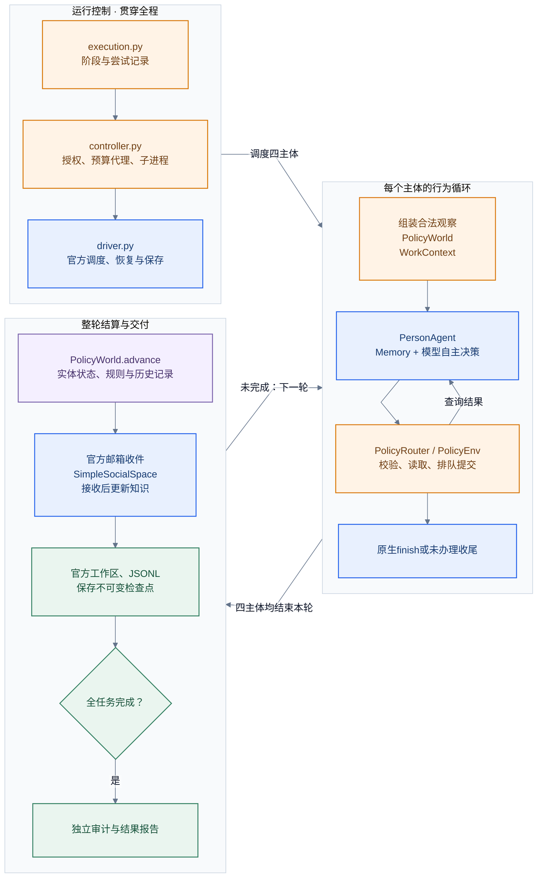

# 重构前的 agent 模拟流程

这是2026-10-31本轮重构前的历史图稿；最新实现见[官方调用流程](proposed-agent-simulation.md)。依据当时源码绘制。箭头表示运行顺序或已标明的数据读写；模型链路为调用关系。四主体在整轮边界结算，接收消息后才获得跨主体信息。

当前流程中：运行控制分布在execution/controller/driver；PolicyWorld同时维护状态、生成候选、组装合法观察并执行结算；WorkContext承担本轮送达、分页和重读处理；官方PersonAgent负责ReAct与Memory，生产主体的选择由模型给出。

可定位的扫描包括core._legal_records对主体记录按对象过滤、core.observe对实体和消息生成视图，以及materials.lawful_sources为每条收到的记录寻找原始送达消息。它们是索引化候选，尚未测得对整场运行耗时的占比。

图稿核对：Mermaid CLI 12.0.0渲染通过，图源与Markdown一致。已逐项核对箭头、模块内容、整轮交付和完成分支；已查看PNG，文字完整、布局可读，评分9/10。跨组箭头表示执行阶段，不是具体函数调用。
