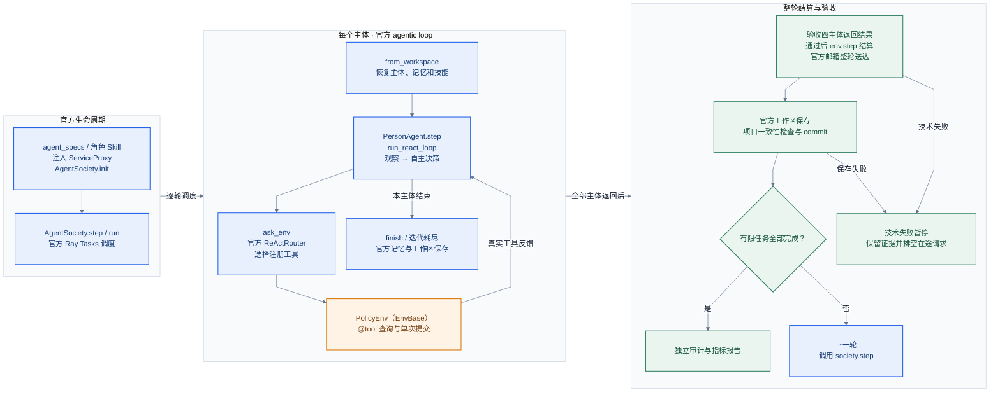

# 按官方 agentic loop 重构的流程图

更新日期：2026-10-31，已实施，限离线验证。完整职责、路由取舍和验收依据见[当前重构设计](../research/v3_1/native-refactor-design.md)，官方能力依据见[2.8.7 调用契约](../research/v3_1/official-agentic-loop-20261031.md)。本图替代上一版以通用运行协调器为中心的提案。

蓝色为官方实现；橙色为政策业务环境；绿色为整轮结算和研究验收。失败箭头表示项目必须保证的结果，不表示框架自动传播全部异常。ReActRouter 是官方支持的替代路由，并非默认 CodeGenRouter；actor 组装、可信上下文、计量与失败验收仍为项目适配。

跨组箭头表示执行阶段。未完成时只再调用 society.step，不重新初始化；技术失败先保存证据，再按现有恢复约定处理。

图稿验收：Mermaid CLI 12.0.0 渲染通过，图源与 Markdown 相同。已查看 PNG，核对全部标签、工具反馈回路、整轮屏障、失败和完成分支；文字完整，流程从左向右，评分 9/10，接受。跨组连线表达阶段，细节以设计说明的调用顺序为准。
